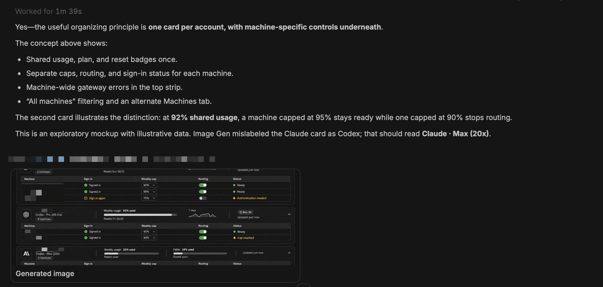

# Turn results

Turn results keeps independently supplied results beside their originating
conversation turn, including when the work section is collapsed. The timeline is
the collection surface. Meaningful results from a turn appear together without
paging or history controls; routine command/address observations remain indexed
and leave no shelf.
There is no composer customization/banner or separate Results panel/action.

The current source increment includes automatic pane-scoped placement, generated
image media through the independent turn-result-images source, and data cards
for the shared result protocol. Historical outcome evidence, current artifact
availability, coverage and source freshness are separate. Missing or pruned
native history does not erase a previously indexed occurrence.

## In use



Actual customer screenshot, shared with permission: a generated image remains
visible beneath its original turn. The image inside the screenshot is an
exploratory account-settings mockup, not implemented account-controls functionality.

## Integration status

Its public dependencies are published exact versions:
`@phosphorco/bb-turn-results@0.1.0` and
`@phosphorco/bb-context-recognition@0.5.1`. Canonical leaf verification uses their
registry archives, independently compared with the reviewed release artifacts.
Source conformance, released-library integration and live native behavior have
separate verification receipts; a successful build alone proves none of them.

No generated dist is committed. Build using the canonical BB workspace CLI,
whose SDK base is 0.6.52, rather than the unrelated npm-installed upstream CLI.
The selected fork SDK has an explicit development suffix.

### Reproduce the installed development inputs

From `/home/ubuntu/bb/community-plugins`, run `npm ci`, then these ordinary leaf
installs. Root workspace installation alone links local contract packages;
these leaf steps select the published registry packages without changing the
maintained manifests or root lock:

```sh
npm install --prefix plugins/turn-results --workspaces=false --include=dev \
  --ignore-scripts --package-lock=false --no-save --no-audit --no-fund \
  --registry=https://registry.npmjs.org \
  /home/ubuntu/bb/sdk-artifacts/get-bb-plugin-sdk-0.6.52+phosphor.975e38f02f1a.sdk.12eb78c20820.tgz
npm install --prefix plugins/turn-result-images --workspaces=false --include=dev \
  --ignore-scripts --package-lock=false --no-save --no-audit --no-fund \
  --registry=https://registry.npmjs.org \
  /home/ubuntu/bb/sdk-artifacts/get-bb-plugin-sdk-0.6.52+phosphor.975e38f02f1a.sdk.12eb78c20820.tgz
npm rebuild --prefix plugins/turn-result-images/node_modules/better-sqlite3 \
  --workspaces=false
npm rebuild --prefix plugins/turn-result-images/node_modules/bun \
  --workspaces=false
```

Use Node 22.21.1 for the selected community SQLite binding. The explicit SDK
archive is the workspace-selected development artifact, SHA-256
`f9bca05575191c8e9be5bf8d641755dbea95cd00853869e9e472b428c366d5ae`.
Contract dependencies keep their exact registry declarations. Repeating root
`npm ci` removes leaf inputs, so repeat both leaf steps afterward.

Install development peers together. In particular, the public SDK app harness,
`@testing-library/react`, React and React DOM must resolve one React instance.
A production-only leaf install can omit the selected development SDK and harness
while optional peers install an upstream SDK or a separate React copy. Package
version equality alone does not establish module identity. Compare the actual
SDK entries and contract files, then run the declared tests and typecheck before
building. This procedure does not reload a running plugin.

The release workflows provision the public fork compiler at commit
`3976be61002511a61ca07f0969ff5838772ed5c0`, verify its materialized tree
`5789e7b1c5405f4bd85b372bc6827716dec8f7a9`, and prepare only the CLI tool.
They start no BB runtime. The ordinary npm launcher forwards builds to that
compiler; the release check requires SDK 0.6.52 metadata and verifies the format
2 frontend generation's files and hashes. SDK installation alone cannot make
an older npm CLI emit the selected artifact format. A successful actual CI run
and reviewed final plugin archive are still release gates.

Gallery owns discovery, scheduling, layout, native row attachment, captions,
navigation, sparse observation storage and resource budgets. Suppliers own
recognition and verified facts. The host never imports another plugin's source.
The original probe helpers remain historical test evidence, not production
image-specific routing or a hard-coded results list. Only the sparse public-row
anchor types are included from that directory in the published package.

Current bounded resources include 128 admitted view leases, 128 queued historical
read units, 64 inactive turn models, and two shared active read lanes with at most
one read per thread. A demanded historical slice reads at most four public
100-segment pages, yielding through shared lanes. One automatic second slice may
continue the same issued snapshot chain for the same live target; the chain stops
at eight pages,1,000 sparse rows or1MiB. No history controls or idle walks are added.
A single Open validates a new latest chain within five seconds and the original
eight-timeline/two-retained-read budget, including any restart. Supplier
work also uses the shared lanes and finite continuation budgets. Native source
slices select at most 32 completions; atomic applications admit at most eight
candidates/resolutions. Media retains at most 64 entries, two active operations
and 32 MiB of verified image blobs. One bounded turn collection follows at most
eight actually issued pages, admitting up to64 rows within256KiB including
row-to-issued-cursor bindings, inside the existing16MiB aggregate budget.
Each settled retained page yields its lane to other demanded turns. Open checks
run first; retained pages, native history and image Media then share FIFO service
before optional supplier work. A collection keeps its original six-second deadline
across queue waits; a slow raw request still owns its credit until settlement.
Validated initial-page positives may display early, with actions and custom hosts
disabled until the collection completes. Partial pages cannot prove absence or
conflict, replace a complete last-good snapshot, or update an authoritative dialog.
Private continuation memory shares the existing budgets. Public advertised RPC
membership narrows descriptor candidates when available; the ordinary current
plugin list and Describe still establish supplier readiness. Unsupported or invalid
metadata uses ordinary discovery, yielding after each legacy owner negotiation.
A transient metadata failure yields one retry from the existing demand budget,
then parks until fresh demand; it never fans out to unrelated plugins. Access
refusal waits for a new readiness generation. Discovery-only slices do not reread
retained collections; source operations still refresh their committed results.
No per-card discovery or hidden all-history
walk is performed. Visible native demand queues one readiness-only discovery
slice per window generation after its first actual history read, so renderer
negotiation can finish while the native boundary is still loading. This uses
the same passive lanes; a slow discovery can delay other queued reads. Actual
public metadata/list/Describe promises remain owned until settlement.

During an already-dispatched fresh latest-rooted history chain, a bounded batch
of body rendering may be coalesced only when every changed subtree preserves
the exact physical row, parent, list and ID, with no structural or owned-root
changes. Proved outside-row chrome may share that batch. Actions and captures
are suspended immediately; only complete public history restores them. Core
thread/config changes, backfill even at an unchanged sequence, connection loss,
unknown batches and physical changes still reset proof. Event silence and equal
snapshot tokens never validate cached older anchors. Actual capacity
may show a quiet limitation beside meaningful results. Successful empty/routine-only turns
have no frame or reserved space; a failed empty read shows its current error until
a genuine successful read clears it. Plain data cards use1x1,
images2x2, and custom presentations their supplied spans. Unresolved guesses are
never cached; resolved geometry follows its source revision. SQLite bounds
and transaction/eviction accounting live in gallery/index.ts and its actual
SQLite tests. Capacity, incomplete coverage and evicted history are explicit.

Optional supplier-owned custom cards use the released CR presentation host.
One window admits at most 64 requests and four occupied custom hosts, including
one dialog and hosts still retiring. Revocation fences callbacks immediately;
credit is released only after committed cleanup or actual owned-root disposal.
A cleanup watchdog reports stalled capacity without reusing it. Data, captions
and native Open remain consumer-owned fallbacks. This does not promise arbitrary
asynchronous or GPU cleanup by an uncooperative contributor.

An app-generation resource owner preserves verified image blobs through native
row/root remounts and pane resize. Source-issued preview URLs are ephemeral and
never enter durable observations; the fetched PNG is independently hashed before
local Blob publication. Media verification joins the same bounded passive read
queue. Once dispatched, its public response stays owned even when a card retires;
a retired card cannot fetch or publish late bytes. This does not prove cancellation
of unobserved remote file work. Queue wait counts toward the unchanged seven-second
media deadline. Native file navigation uses the source's explicit host.

An already-dispatched, bound image response may remain data after its card leaves
the viewport while the same physical root, runtime SDK owner and source generation
remain live. A replacement card must prove current native placement and read its
actually issued retained page with the same identity, target, SHA and corrections
before a GET. No adopter means no GET. Settled response data without a visible
adopter yields to eligible foreground image demand; visible proof waiters and
active fetches keep their ownership. This spends the original seven-second budget,
including correlation, and does not extend a lease or grant Open authority.
Historical origin remains unknown unless the source recorded it.

A public per-header bridge supplies the actual thread id and that surface's
committed native navigation callbacks. It proves a unique local thread window
from its own DOM ancestry; ambiguous/foreign scopes refuse. Its own empty header
wrapper is hidden from layout and accessibility. No global thread-id lookup or
private React context supplies pane ownership. Native history remains a bounded proof input; missing boundaries never invent
a completed turn, history invitation or collection. One concise event caption
accompanies content, and only meaningful file/URL destinations offer Open.
Source clocks/provenance remain in facts without permanent diagnostic footers.

Once the frontend is already loaded, its committed current-thread header and
strict project/thread message-jump route may start one bounded fresh history
chain before a source row arrives. An independent proximity hint selects at most
two actual offscreen rows within one viewport; leaving that horizon retires that
hint without cancelling the separate route intent. These jobs share the existing
turn snapshots and image owner, with at most two warm turns and two warm images.
They never mount hidden custom canvases or enumerate suppliers speculatively.
Open and foreground work precede queued speculative work. An already-dispatched
Media response keeps its lane until settlement; a foreground owner promotes the
same queued request instead of aborting and reissuing it.

Only a continuously live semantic generation with both transports connected may
hand its fresh history chain to one exact first physical arrival. Unknown or
structural mutations, removal/replacement, scope changes, semantic events,
connection loss and hiding permanently retire that adoption. Verified data and
Blob bytes may remain, but new foreground public proof and retained collection
are required before actions or custom admission. Native message jumps commonly
replace existing rows, so that path can benefit from bytes without reusing
placement proof. No equal snapshot token validates cached history. Initial host
loading of the plugin executable is an independent floor: this scheduling does
not run before its frontend exists and does not promise cross-session preloading.
Speculative reads can spend existing lane time and deadlines on content the
reader ultimately skips; they do not increase any read, byte or lease budget.

## Frontend startup

The committed public header starts the existing bounded native-history reader
through a lean shared work owner while the rendering and supplier implementation
loads. Content activation starts that code fetch immediately without awaiting it;
its initial network and parse work is not eliminated or postponed until demand. The same two-window, one-thread queue owns the early pages and later
runtime work, including raw settlement, Open priority and queued-latest waiter
charges. Issued cursors and sparse-row byte limits are processed before rendering
code arrives; attaching the implementation does not replay that live chain.
When the implementation is available, readiness-only listed/Describe negotiation
can use the next shared slot after latest history. Unloaded code cannot put that
negotiation ahead of an older page already in flight, and history never waits for
code to preserve that ordering. No source enumeration, retained-result work,
custom canvas or action starts from the page request alone. Current native proof
and normal source gates still control placement and actions.

This begins only after the host commits the real SDK-backed header. It does not
supply a pre-slot SDK, bypass host loading, or establish a native latency gain.
Retirement, hide, transport, semantic and physical changes keep their existing
proof resets; late module completion cannot restore retired authority. A failed
implementation load displays a local failure and does not loop import retries or
clear on proof restart. Reloading into a working frontend generation supplies a
genuine recovery path. Module-load tests and emitted static-import bytes are
separate evidence from native startup timing.

## Bounded owner work

Each demanded owner prepares its resolve, source-invalidation, feed and native
checkpoints in one indexed SQLite read transaction. Every following Apply still
checks the captured invalidation version inside its own atomic transaction, as
well as the stage CAS. Even an identical new invalidation advances that guard.
Feed, recognition and resolution commits remain separate, so an earlier valid
feed survives a later refusal. Equal ordinary checkpoints can avoid a redundant
write only after CAS; invalidation and maintenance checkpoints do not use that
shortcut. Genuine supplier freshness updates still commit and refresh retained
rows. A wholly unchanged owner can yield without another retained collection.

Within one continuously live full anchor and source generation, owners may
reuse one exact selected native query until the originating six-second slice
ends; a borrowing owner cannot extend that window's deadline. The existing
entry and window byte budgets charge preparation and selected
data. Optional reuse yields to useful foreground facts under memory pressure;
active raw work retains its charge until settlement. Resets, full anchor changes,
source readiness revocation and retirement discard reuse eligibility. The
record holds selected data and bounded validity tokens, never raw provider
payloads, promises or unit closures, and grants no placement or action authority.

Actual native, supplier and Gallery transports within an owner unit serialize
through their real public promise settlement. A local helper timeout does not
release its thread slot or let a status write overlap ignored source work.
Queued calls recheck the original deadline, supplied signal and generation
before dispatch; expired work does not run. The existing FIFO yields between
owners, with the same two-window/one-thread limits. Consistent preparation adds
explicit read transactions and invalidation guard reads; fewer RPCs or repeated
checkpoint writes do not imply universally less SQLite work or faster native
rendering.

## Verification limits

Source tests cover registered suppliers and real SQLite, retained history,
bounded owner/claim continuation, public timeline invalidation, and actual React
presentation teardown. They do not establish a host's current file availability,
remote reachability or native behavior at every scale. Native scroll, focus,
pane/window changes, varied contributor results and remote preview need separate
live verification against the actual served frontend generation.

Initial native-image candidates may request the existing Images Media operation while still unresolved. The source independently admits native evidence and matching file bytes within its single 3-second request, then commits its normal sparse resolution before issuing a lease. Gallery performs ordinary Resolve, Apply, and the row's actually issued retained-page Read before validating the lease fingerprint/SHA or fetching bytes. All correlation and GET/hash work stays inside the existing 7-second Media budget; starting admission grants no file Open, custom canvas, or confirmed-generation label.

The existing Media owner can fill a previously unknown same-claim binding once after that correlation. Candidate-to-resolved rendering retains the same attempt and Blob owner; verified target/SHA cannot change. A settled unbound error can take a new current correlation owner for explicit Retry after reentry, without an idle retry or replacing an in-flight promoted response. Source facts can remain committed when later consumer publication fails. This route does not promise native completion within either unchanged budget.


On initial startup with an explicit message-jump sequence and an already mapped
native pane, route warming waits for
the first actual foreground demand and its first fresh native-proof result.
A complete result covering the exact message-jump sequence may omit that one
optional route job only while the same unique physical row/list/pane is still
foreground in the same live generation. This omits work; it transfers no proof
or action authority. Empty demand and unmapped panes keep ordinary pre-arrival
warming; explicit later route jumps and nearby hints keep their existing paths.
A no-hash latest-route goal keeps the original immediate warming/sharing path.
Incomplete or mismatching explicit-goal proof can release the original optional
intent once; no timer or foreground retry is added. Physical,
semantic, transport, target-set or scope retirement drops that intent rather
than reviving it from a later response. An initial mapped pane with nonempty foreground demand can delay optional
offscreen route warming until that first foreground result; pre-arrival timing
is not universally unchanged. This trades optional initial warming
latency for useful foreground precedence, without changing the history budget.

A decoded Images `source-timeout` permits one automatic recovery only for the
still-shown, current originating bound foreground adopter. It uses the same
Media controller, token and original seven-second budget, after the public RPC
has actually settled, and rejoins the ordinary foreground FIFO. Current row,
visibility and immutable binding are checked again at actual queued dispatch.
A replacement card cannot borrow that eligibility. Initial unresolved candidates
have no such bound adopter and remain manual-only. Generic errors (even identical
text), capacity, contract, GET/hash/decode failures, retirement and deadline expiry
do not recover automatically; a failed recovery stays a truthful manual error.
Source inner ports may still hold the existing source credits after the public
response, so recovery can encounter capacity or exhaust the original remaining
time. This adds at most one verification on that failure path, not a healthy-call
reduction or a guarantee of recovery or native latency.
